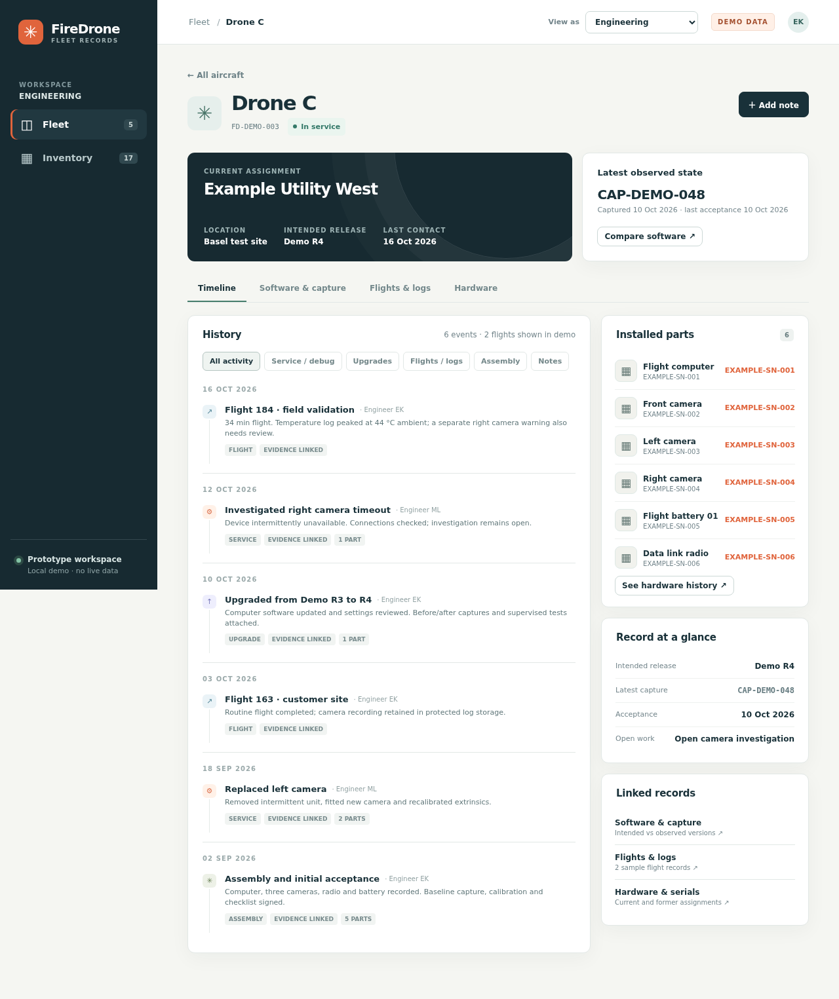

# FireDrone fleet records UI mockup

Static, self-contained prototype for exploring a per-drone history and shared parts inventory. All drone, part, customer and event information is fictional demo data. Notes entered in the UI are kept in this browser's `localStorage` only.

[Software comparison preview](preview-software.png) · [Flight log and route preview](preview-flight.png) · [Customer dashboard preview](preview-customer-home.png) · [Customer flight preview](preview-customer.png)

## Run locally

Open `index.html` in a browser, or serve this directory with `python3 -m http.server 8000` and visit `http://localhost:8000`.

## GitHub Pages

The [live demo](https://firedrone-ag.github.io/firedrone-fleet-ui/) is published from `main`. The site has no build step, server, external CDN dependency, or absolute asset paths. No real drone logs or customer data should be placed in this public Pages deployment.

## What to explore

- **Fleet**: search and filter drones, then open a drone to see its timeline, current parts, captures, logs and service history.
- **Inventory**: search/filter parts by status or type, open a part to see where it is and its movement history.
- **Drone timeline**: filter by activity, open events for evidence and related parts, and add a local demo note.
- **Software & capture**: compare an intended release to a dated observed snapshot, with generic example source labels. Unknown and drift states are illustrated.
- **Flights & logs**: browse fictional flight summaries, sensor state, log bundle references and in-flight ambient/computer/battery temperature traces. The route drawing is schematic and does not represent real geography or telemetry. Temperature review is illustrative; no operating limit is defined by this demo.
- **Hardware**: inspect each installed part's model, revision, serial, age/cycle reading, inspection result and movement history.
- **View as**: switch between engineering and an Example Utility West customer dashboard. Its stats summarize only assigned aircraft and flights; the customer can open flight summaries, ambient/computer/battery temperature traces and log references. The selector demonstrates the presentation only; this public static site has no authentication or data access control.

This is a UI sketch, not the storage model or a production workflow. The intended release, observed capture and engineer's service record are shown separately to make that boundary visible.
All log IDs, filenames, customer names, serials, routes, versions and measurements are fictional examples. No log files or actual maps are served by this site.
Keep hardware and software examples generic: cameras, computers and placeholder sources only. Do not add vendor models, part numbers or real repository names to this public demo.
